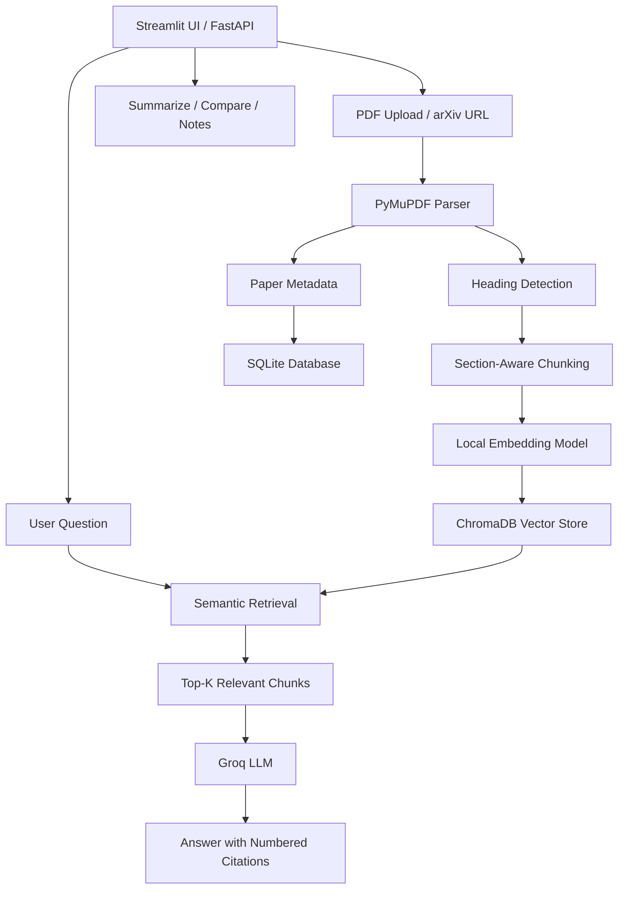

## 🚀 Live Demo

**Try Research RAG online:** [Launch Research RAG](https://research-rag-z0c8.onrender.com)

Explore AI-powered research paper summarization, citation-grounded question answering, and multi-paper comparison.

# Research RAG — AI-Powered Research Paper Assistant

**Turn research papers into actionable insights with Retrieval-Augmented Generation (RAG).**

Research RAG is an AI-powered research assistant that enables users to upload research papers in PDF format or retrieve them from arXiv, ask context-aware questions, generate summaries, compare multiple papers, and save research notes. It combines section-aware document processing, semantic search, vector retrieval, and large language models to deliver answers grounded in the source documents with numbered citations.

## Overview

Research papers often contain dense technical content, making it time-consuming to locate specific findings, understand methodologies, and compare results across publications.

Research RAG simplifies this process by creating a searchable research library and using Retrieval-Augmented Generation (RAG) to retrieve relevant passages before generating answers.

Instead of relying solely on an LLM's pretrained knowledge, Research RAG uses retrieved paper content to ground its responses and help users verify the supporting evidence.

## Key Features

- **PDF & arXiv Ingestion:** Upload research papers or retrieve papers from arXiv for processing.
- **Section-Aware Chunking:** Extract text using PyMuPDF, detect document headings, and organize content into meaningful chunks.
- **Semantic Search:** Generate local embeddings and index document chunks in ChromaDB for similarity-based retrieval.
- **Citation-Grounded Q&A:** Ask questions about research papers and receive answers supported by numbered citations linked to retrieved passages.
- **Automated Summarization:** Generate concise summaries of research papers to understand their key contributions.
- **Multi-Paper Comparison:** Compare papers across research objectives, methodologies, findings, and limitations.
- **Research Notes:** Save and manage notes associated with paper metadata using SQLite.
- **Interactive Web Interface:** Explore papers, ask questions, summarize content, compare publications, and manage notes through Streamlit.
- **REST API:** Access core functionality through FastAPI endpoints for integration with custom frontends.
- **Duplicate Ingestion Prevention:** Avoid redundant processing when the same paper is uploaded again.
- **Configurable LLM:** Configure the Groq-hosted model through environment variables without changing application code.

## System Architecture



### How It Works

1. **Document ingestion:** The application accepts a PDF or an arXiv source and extracts its text.
2. **Document parsing:** The parser identifies headings and organizes the extracted content into section-aware chunks.
3. **Embedding generation:** A local embedding model converts each chunk into a numerical vector.
4. **Indexing:** ChromaDB stores the vectors and associated metadata for efficient similarity search.
5. **Context retrieval:** When a user asks a question, the system retrieves the top-k relevant chunks.
6. **Answer generation:** The retrieved context is passed to a Groq-hosted LLM, which generates a context-grounded response with numbered citations.
7. **Persistence:** SQLite stores paper metadata and research notes, while the vector store maintains the searchable document index.

## Technology Stack

| Component | Technology | Purpose |
|---|---|---|
| Programming Language | Python | Application logic and RAG pipeline |
| PDF Processing | PyMuPDF | Text extraction and document parsing |
| Embeddings | Local embedding model | Convert text into semantic vectors |
| Vector Database | ChromaDB | Store embeddings and retrieve relevant passages |
| LLM Inference | Groq API | Generate answers, summaries, and comparisons |
| Frontend | Streamlit | Interactive research assistant interface |
| Backend API | FastAPI | Expose functionality through REST endpoints |
| Metadata & Notes | SQLite | Persist paper metadata and research notes |
| Testing | pytest | Validate application behavior |
| Configuration | Environment variables | Manage API keys and model settings |

## Project Structure

```text
Research-RAG/
├── papermind/
│   ├── parser.py       # PDF extraction, heading detection, chunking
│   ├── store.py        # ChromaDB indexing and retrieval
│   ├── llm.py          # LLM prompts, Q&A, summaries, comparisons
│   ├── db.py           # SQLite metadata and notes
│   └── ingest.py       # Document ingestion pipeline
├── data/               # Local application data and persistence
├── tests/              # Automated tests
├── app.py              # Streamlit application
├── api.py              # FastAPI backend
├── requirements.txt    # Python dependencies
├── .env                # Environment variable template
├── .gitignore
└── README.md
```

## Getting Started

### Prerequisites

- Python 3.10 or later, compatible with the project's dependencies
- A Groq API key
- Git

### 1. Clone the Repository

```bash
git clone <https://github.com/pnikhilkumarnaik/Research-RAG>
cd Research-RAG
```

Replace the repository URL with your GitHub repository URL.

### 2. Create a Virtual Environment


**Linux / macOS**

```bash
python -m venv .venv
source .venv/bin/activate
```

### 3. Install Dependencies

```bash
pip install -r requirements.txt
```

### 4. Configure Environment Variables

Create a `.env` file from the example:


**Linux / macOS**

```bash
cp .env
```

Add your Groq API key and configure the model:

```env
GROQ_API_KEY=your_groq_api_key
LLM_MODEL=openai/gpt-oss-120b
```

Use a model currently available to your Groq account. If the configured model is unavailable, check the fallback model configuration in `papermind/llm.py`.

Get an API key from the [Groq Console](https://console.groq.com/).

**Security:** Never commit your `.env` file or expose API keys in source code.

### 5. Run the Application

Launch the Streamlit interface:

```bash
streamlit run app.py
```

Open `http://localhost:8501` in your browser.

### 6. Run the FastAPI Backend

To expose the application through a REST API:

```bash
uvicorn api:app --reload
```

- API base URL: `http://localhost:8000`
- Interactive API documentation: `http://localhost:8000/docs`
- Alternative API documentation: `http://localhost:8000/redoc`

### 7. Run Tests

Install pytest if it is not already included:

```bash
pip install pytest
pytest -q
```

## Example Use Cases

### Research Question Answering

**Question:** What problem does this paper address, and what is its primary contribution?

**Expected behavior:** Retrieve relevant passages from the paper and generate an answer with numbered citations to the supporting chunks.

### Research Paper Summarization

**Request:** Summarize the paper's objective, methodology, key findings, and limitations.

**Expected behavior:** Generate a structured summary using the available paper content.

### Multi-Paper Comparison

**Request:** Compare two research papers based on their methodologies, datasets, findings, and limitations.

**Expected behavior:** Retrieve relevant information from both papers and organize the differences into a clear comparison.

### Research Note-Taking

**Request:** Save important observations or questions for a paper.

**Expected behavior:** Persist notes and associate them with the relevant paper metadata.

*The examples describe intended application behavior. Actual citation accuracy, comparison quality, and retrieval performance should be validated against representative research papers.*

## Design Decisions

### Why RAG?

RAG retrieves relevant source passages before answer generation. This helps ground responses in the uploaded research material and makes it easier to trace claims back to their sources.

### Why Section-Aware Chunking?

Fixed-size chunking can split equations, arguments, or explanations across unrelated boundaries. Using document headings and section context can preserve more meaningful relationships between passages.

### Why ChromaDB?

ChromaDB provides a straightforward local vector-search solution for prototyping and running a research assistant without requiring a managed vector database.

### Why Local Embeddings?

Local embedding generation reduces dependence on an external embedding API and avoids requiring a separate embedding-service key. The trade-off is local CPU/RAM usage and embedding-model download or storage requirements.

### Why Separate the LLM Layer?

Keeping LLM prompts and inference logic inside `papermind/llm.py` separates generation from parsing, storage, and application interfaces. This makes model changes and prompt experiments easier to manage.

## Current Limitations

- Complex two-column layouts, tables, equations, and scanned PDFs may require specialized parsing or OCR.
- Citation quality depends on retrieval accuracy and correct mapping between chunks and source locations.
- Long-paper summaries may be limited by configured input size and model token limits.
- Groq API rate limits can affect throughput and large-document processing.
- Local persistence requires appropriate storage management and backups.
- User authentication and isolated per-user document libraries require additional implementation.

## Future Improvements

- **Hybrid Search:** Combine BM25 keyword retrieval with vector similarity search.
- **Reranking:** Reorder retrieved passages using a cross-encoder or another relevance model.
- **Evaluation Framework:** Measure retrieval hit rate, answer faithfulness, citation precision, and response latency.
- **PDF Highlights:** Display cited passages in a document viewer with page-level references.
- **Conversation Memory:** Support follow-up questions while preserving the relevant paper context.
- **Scalable Storage:** Introduce PostgreSQL with pgvector or a managed vector database when appropriate.
- **Authentication:** Implement secure user accounts and isolated research libraries.
- **Caching:** Cache repeated queries and paper summaries to reduce latency and inference costs.
- **Deployment:** Deploy the frontend and API separately, with persistent storage for document indexes and metadata.

## Deployment

- **Streamlit application:** Streamlit Community Cloud or a suitable container platform.
- **FastAPI backend:** Render, Railway, Fly.io, or AWS.
- **Custom frontend:** Next.js or React hosted separately from the Python backend.
- **Persistent data:** Use persistent volumes or managed storage for the vector index, SQLite database, and other application files.

Before deployment, configure secrets securely, validate file-upload limits, restrict unsafe URL handling, and test persistence across application restarts.

## Testing and Evaluation

Recommended evaluation areas:

| Metric | What It Measures |
|---|---|
| Retrieval Hit Rate | Whether relevant passages appear in the retrieved top-k results |
| Citation Precision | Whether cited passages actually support the associated claims |
| Answer Faithfulness | Whether generated statements are supported by retrieved context |
| Retrieval Latency | Time required to retrieve relevant passages |
| End-to-End Latency | Total time required to generate an answer |
| Ingestion Reliability | Whether papers are parsed, indexed, and stored correctly |

A practical evaluation dataset should contain representative questions and verified supporting passages from multiple papers. Report measured results only after running the evaluation.


---

**Research RAG — Read less manually. Discover more intelligently.**